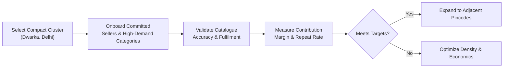
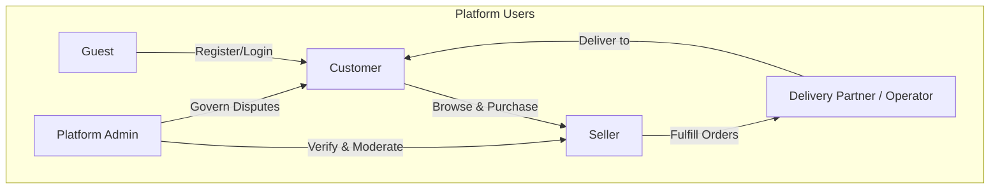
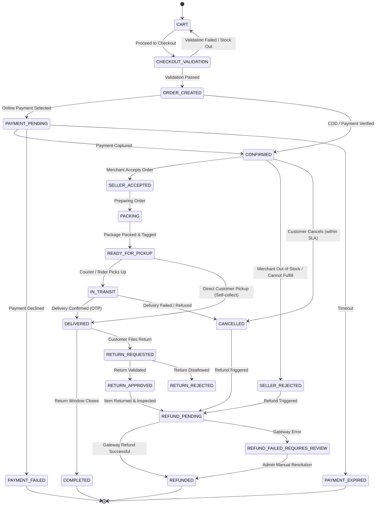
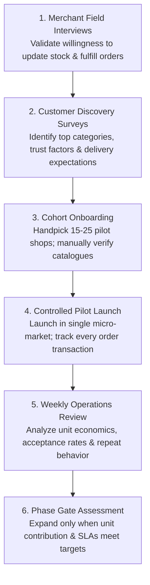

# Local Commerce Marketplace — Business Idea & Business Logic

> **Document Type:** Business-first Concept Document for Product Planning & Implementation  
> **Version:** 1.0 | Draft for Validation  
> **Date:** 16 October 2026  
> **Scope & Focus:** Customer value, seller value, marketplace rules, operating workflows, revenue models, unit economics, and business acceptance criteria. *(Technical infrastructure and deployment details are intentionally excluded).*

---

## Table of Contents
1. [Executive Summary](#1-executive-summary)
   - [1.1 The Core Idea](#11-the-core-idea)
2. [The Problem](#2-the-problem)
3. [Proposed Solution](#3-proposed-solution)
4. [Target Customers and Initial Market](#4-target-customers-and-initial-market)
   - [4.1 Initial Customer Segments](#41-initial-customer-segments)
   - [4.2 Suggested Pilot](#42-suggested-pilot)
5. [Value Proposition](#5-value-proposition)
6. [Business Model and Revenue](#6-business-model-and-revenue)
   - [6.1 Potential Revenue Streams](#61-potential-revenue-streams)
   - [6.2 Unit Economics](#62-unit-economics)
   - [6.3 Commercial Rules to Decide](#63-commercial-rules-to-decide)
7. [Business Participants and Roles](#7-business-participants-and-roles)
8. [Core Business Rules (BR-001 to BR-018)](#8-core-business-rules)
9. [End-to-End Business Workflows](#9-end-to-end-business-workflows)
   - [9.1 Customer Discovery](#91-customer-discovery)
   - [9.2 Seller Onboarding and Shop Setup](#92-seller-onboarding-and-shop-setup)
   - [9.3 Product and Inventory Management](#93-product-and-inventory-management)
   - [9.4 Cart and Single-Shop Checkout](#94-cart-and-single-shop-checkout)
   - [9.5 Order Fulfilment](#95-order-fulfilment)
   - [9.6 Payment and Reconciliation](#96-payment-and-reconciliation)
   - [9.7 Cancellation, Return and Refund](#97-cancellation-return-and-refund)
10. [Order Lifecycle](#10-order-lifecycle)
11. [Admin and Marketplace Governance](#11-admin-and-marketplace-governance)
12. [Customer Trust and Service Quality](#12-customer-trust-and-service-quality)
13. [Business Metrics](#13-business-metrics)
14. [Risks and Mitigations](#14-risks-and-mitigations)
15. [MVP Acceptance Criteria](#15-mvp-acceptance-criteria)
16. [Assumptions and Decisions to Validate (BIZ-001 to BIZ-012)](#16-assumptions-and-decisions-to-validate)
17. [Recommended Business Validation Plan](#17-recommended-business-validation-plan)
18. [Summary](#18-summary)

---

## 1. Executive Summary

The **Local Commerce Marketplace** is a digital platform designed to help customers discover and purchase products from nearby independent shops. It equips local brick-and-mortar retailers with an online storefront and a streamlined mechanism for receiving customer orders, eliminating the heavy cost and complexity of building and maintaining standalone e-commerce systems.

The platform operates as a marketplace intermediary:
* Enables hyper-local customer discovery of nearby shops.
* Presents shop-owned product listings and live availability.
* Coordinates order placement, checkout validation, and status notifications.
* Facilitates or coordinates order fulfilment and delivery.

> [!NOTE]
> **Core Differentiation:**  
> The business preserves existing local shop-customer relationships and competes on **relevance, trust, transparent pricing, and convenient access**—rather than pure delivery speed alone.

### 1.1 The Core Idea
* **Hyper-local Discovery:** Customers select an area or permit geolocation, browse eligible nearby stores, explore inventory and pricing, and place orders.
* **Merchant Autonomy:** Each shop controls its own catalogue, pricing, inventory stock, and order acceptance within platform guardrails.
* **Transparent Monetization:** The platform earns from clearly disclosed commissions or margins, delivery charges (where applicable), and optional seller value-added services introduced in later phases.
* **Density-Driven Pilot:** Launch begins within a tightly scoped geographic area to validate demand, customer repeat rates, and order unit economics before geographic expansion.

---

## 2. The Problem

Small independent retailers struggle to build digital visibility, keep catalogues updated online, and compete against mega e-commerce and quick-commerce platforms. Concurrently, consumers frequently lack visibility into which local neighborhood shops carry specific products, whether shops are open, and what items are actually in stock.

| Stakeholder | Problem | Opportunity |
| :--- | :--- | :--- |
| **Local Retailers** | Limited digital visibility, lack of consistent online ordering channels, and inability to reach nearby consumers beyond walk-in foot traffic. | Provide a straightforward digital storefront, instant order alerts, self-serve product/inventory tools, and access to local digital demand. |
| **Customers** | Difficulty discovering nearby specialty stores and comparing local product selections, prices, and instant availability. | Make neighborhood shops easily searchable, display transparent pricing and stock, and simplify local ordering. |
| **Marketplace Operator** | Must generate consumer trust and repeat purchasing habits while keeping order fulfilment and delivery unit economics sustainable. | Drive revenue via transparent, measurable transactions while building order density in focused service clusters. |

---

## 3. Proposed Solution

* **Location-Aware Discovery:** Dynamic discovery interface showing stores verified to serve the customer’s selected locality or postal pincode.
* **Shop Storefronts:** Individual shop profiles displaying operational status (open/closed), operating hours, product media (photos/videos), selling price, list price (MSRP/MRP), applied discounts, and stock status.
* **Merchant Portal:** Self-service tools enabling merchants to manage business details, operating hours, catalogue entries, price levels, and inventory adjustments.
* **Shop-Partitioned Cart & Single-Shop Checkout:** A multi-shop cart structure where items are grouped by shop, enforcing checkout with **exactly one shop per order**.
* **Real-time Order Updates:** Automated notifications for customers and sellers across the order lifecycle, with integrated or coordinated delivery.
* **Marketplace Administration:** Centralized admin governance for seller verification, store approval, catalogue moderation, dispute handling, and transaction audits.

---

## 4. Target Customers and Initial Market

### 4.1 Initial Customer Segments
* **Local Loyals:** Residents who prioritize purchasing from trusted neighborhood merchants.
* **Convenience Seekers:** Customers seeking rapid, convenient access to everyday goods without visiting multiple physical stores.
* **Specific Item Searchers:** Shoppers looking for a particular product, brand, or SKU available at a nearby retailer.
* **Neighborhood Retailers:** Independent merchant owners wanting incremental digital sales volume alongside their walk-in trade.

### 4.2 Suggested Pilot

Initiate operations within a single compact geographic cluster (e.g., a defined sector of **Dwarka, Delhi**), post confirmation of merchant readiness and delivery feasibility. Curate a small cohort of committed shops across select initial categories.

| Pilot Decision | Suggested Approach | Why It Matters |
| :--- | :--- | :--- |
| **Geography** | One defined locality or a small set of contiguous pincodes (e.g., Dwarka, Delhi). | Builds the necessary order density to test delivery economics and consumer repeat rates. |
| **Seller Mix** | Small, committed group of active, tech-receptive merchants. | Keeps merchant onboarding, catalogue quality verification, and operational support manageable. |
| **Categories** | Curate categories based on demonstrated merchant stock and customer demand. | Prevents launching a wide but shallow or empty catalogue. |
| **Operating Hours** | Enforce publishing of reliable shop hours and real-time open/closed status. | Eliminates failed checkout attempts and customer frustration with unavailable stores. |
| **Expansion Gate** | Scale only after fulfilment quality, order acceptance, and contribution margin per order hit predefined benchmarks. | Prevents scaling operating losses alongside volume growth. |

---

## 5. Value Proposition

| For Customers | For Sellers | For the Platform |
| :--- | :--- | :--- |
| Find nearby shops and relevant products instantly. | Reach neighborhood customers beyond physical walk-in footfall. | Monetize completed, high-intent local transactions. |
| Real-time shop-specific pricing and stock visibility. | Maintain complete ownership of catalogue, pricing, and stock. | Build local hyper-local supply and demand density. |
| Order from trusted, known local merchants. | Receive clear order notifications and simple fulfilment tools. | Identify product categories and areas with sustainable unit economics. |
| Transparent delivery fees and fulfilment estimates before payment. | Drive incremental revenue without investing in custom mobile apps. | Establish an operationally sound, repeatable local marketplace blueprint. |

---

## 6. Business Model and Revenue

### 6.1 Potential Revenue Streams

| Revenue Stream | How It Works | Business Guardrail |
| :--- | :--- | :--- |
| **Seller Commission** | Marketplace retains an agreed percentage of the eligible completed order subtotal. | Rates, eligible subtotals, tax compliance (GST/TCS), refund clawbacks, and settlement cycles must be formalized in merchant agreements. |
| **Product Margin / Markup** | Platform applies an agreed difference between seller wholesale price and customer retail price where lawful. | Never mix margin and commission ambiguously; ensure the price displayed to customers and net merchant payout are completely transparent. |
| **Delivery Fee** | Customer pays a clear delivery fee when logistics are fulfilled or coordinated by the platform. | Fee should accurately reflect distance, logistics model, minimum basket size, and actual delivery cost. |
| **Promoted Placement** | Sellers pay for optional featured placement or category campaign visibility (future phase). | Sponsored listings must be explicitly badged and never compromise customer discovery trust or algorithmic fairness. |
| **Seller Tools (SaaS)** | Optional premium analytics, advanced inventory management, or marketing tools. | Do not charge baseline fees for core marketplace participation until seller value and willingness to pay are validated. |

### 6.2 Unit Economics

Unit economics must be evaluated on **Contribution Per Completed Order**, not gross transaction volume.

$$\text{Net Platform Revenue per Order} = (\text{Commission or Margin}) + (\text{Platform-retained Delivery Fee}) + (\text{Other Platform Fees}) - (\text{Platform-funded Discounts}) - (\text{Platform-funded Refunds/Reversals})$$

$$\text{Contribution per Order} = \text{Net Platform Revenue per Order} - (\text{Payment Gateway Costs}) - (\text{Logistics / Fulfilment Costs}) - (\text{Variable Customer Support Costs}) - (\text{Other Variable Transaction Expenses})$$

> [!IMPORTANT]
> A positive contribution is not guaranteed merely by charging a commission or delivery fee. Key variables—Average Order Value (AOV), order frequency, merchant commission acceptance, courier delivery costs, cancellation rates, promotional subsidies, and gateway fees—must be validated during the live pilot.

### 6.3 Commercial Rules to Decide
1. **Delivery Fee Allocation:** Who covers the delivery fee (customer, merchant subsidy, or shared), and under what minimum order thresholds?
2. **Pricing Structure:** Whether the platform operates on commission-on-sale, retail markup, or tiered subscription models.
3. **Payout Settlement Schedule:** Whether merchant disbursement occurs T+1/T+2 post-delivery, weekly, or upon closure of return windows.
4. **Deduction and Adjustment Policy:** How order cancellations, partial order fulfilment, returns, payment gateway charges, and tax withholdings impact merchant payouts.
5. **Cash on Delivery (COD):** Whether COD is permitted at launch, and how cash collection, reconciliation, and delivery boy leakage are managed.

---

## 7. Business Participants and Roles

| Role | Business Purpose | Key Permitted Actions |
| :--- | :--- | :--- |
| **Guest** | Explore the marketplace prior to onboarding. | Select/change location; view active shops and products; initiate registration or sign-in. |
| **Customer** | Discover and purchase from local retailers. | Manage user profile and delivery addresses; browse catalogue; manage cart; place and track orders; initiate support or cancellation requests. |
| **Seller** | Operate one or multiple neighborhood storefronts. | Apply for merchant status; submit KYC/business documents; configure shop profile, operating hours, catalogue, stock, and process orders. |
| **Admin** | Protect platform integrity, trust, and policy compliance. | Verify and approve sellers/shops; moderate catalogue content and pricing; handle dispute escalations; manage role permissions; inspect audit logs. |
| **Delivery Partner / Operator** | Transport completed orders from shop to customer. | Receive delivery dispatches; verify physical pickup; update transit states; record proof of delivery or failed delivery attempts. |

> [!NOTE]
> The **Delivery Partner** role represents an operational capability. During the initial launch, fulfilment may be handled directly by the merchant or outsourced to a 3rd-party hyperlocal logistics provider rather than requiring a dedicated in-house fleet app.

---

## 8. Core Business Rules

| Rule ID | Category | Business Rule Statement |
| :---: | :--- | :--- |
| **BR-001** | **Location Fallback** | Location access is optional. If denied by the customer, manual selection of locality/pincode is mandatory. Fallback pilot region: Dwarka, Delhi. |
| **BR-002** | **Discovery Boundary** | Shop discovery is strictly constrained to the customer's selected locality and each shop's configured service radius. |
| **BR-003** | **Shop State vs Approval** | Shop open/closed status is independent of seller account approval. Closed shops may remain discoverable for catalogue browsing but are blocked from order intake. |
| **BR-004** | **Listing Authorization** | Only admin-verified and approved sellers can activate shops and publish purchasable products. |
| **BR-005** | **Merchant Ownership** | A seller may own and manage multiple shops; each shop is owned by exactly one seller entity. |
| **BR-006** | **Product Context** | Every product listing is strictly bound to a specific shop. Inventory stock and selling prices are evaluated exclusively within that shop’s context. |
| **BR-007** | **Single-Shop Checkout** | A customer's cart may hold items from multiple shops (grouped by shop), but **each checkout and resulting order must contain items from exactly one shop**. |
| **BR-008** | **Price Transparency** | Selling prices, applicable discounts, delivery fees, and taxes must be fully computed and visible before order confirmation. No hidden fees at the final payment step. |
| **BR-009** | **Authoritative Calculation** | The platform server is the sole authoritative source for pricing, stock validation, promotional limits, delivery fees, and payable totals. |
| **BR-010** | **Checkout Revalidation** | Placing items in a cart does not reserve inventory. Stock availability and item pricing are revalidated atomically at the moment of checkout. |
| **BR-011** | **Order Snapshotting** | Every order must record an immutable snapshot of item names, quantities, unit prices, discounts, taxes, and merchant details at the time of purchase. |
| **BR-012** | **Seller Isolation** | Sellers can access and modify only their own store settings, product listings, inventory records, and assigned orders. |
| **BR-013** | **Customer Isolation** | Customers can access only their personal profile, delivery addresses, shopping carts, and order history. |
| **BR-014** | **State Machine Integrity** | Order state changes must strictly follow permitted lifecycle transitions, recording the actor ID, reason code, and timestamp for all transitions. |
| **BR-015** | **Idempotent Transactions** | Duplicate payment webhook events or retried customer submissions must never result in duplicate orders, duplicate charges, incorrect stock deductions, or duplicate refunds. |
| **BR-016** | **Disclosed Policies** | Cancellation, return, refund, and merchant settlement policies must be transparently disclosed to all parties and enforced consistently. |
| **BR-017** | **Admin Auditability** | All administrative actions impacting merchant verification, store suspension, pricing/discounts, financial payouts, or user privileges must require explicit justification and generate an immutable audit log. |
| **BR-018** | **Stock Enforcement** | Out-of-stock items cannot be ordered unless a formalized back-order or pre-order business policy is explicitly configured. |

---

## 9. End-to-End Business Workflows

### 9.1 Customer Discovery
1. Customer accesses the marketplace web or mobile landing page.
2. The platform prompts for geolocation permission; declining gracefully allows manual selection of locality or postal code.
3. Customer confirms their locality/pincode (default fallback: Dwarka, Delhi).
4. System displays verified shops serving that boundary, clearly highlighting open vs. closed status.
5. Customer selects an open shop and browses its active catalogue.
6. Customer reviews product details, specifications, retail prices, active discounts, and stock status.

### 9.2 Seller Onboarding and Shop Setup
1. Merchant registers an account and submits a seller application.
2. Merchant submits mandatory KYC/business verification documents (e.g., GSTIN, PAN, business proof, bank account details).
3. Admin audits documentation and approves, rejects, or flags the application for additional information.
4. Upon approval, merchant creates their shop profile (store name, physical address, geo-coordinates, service radius, operating hours).
5. Merchant configures operational parameters and uploads initial catalogue items.
6. Merchant specifies stock quantities and verifies listing details before toggling the store to active status.

### 9.3 Product and Inventory Management
1. Seller selects the designated shop they are authorized to manage.
2. Seller creates a product record (title, description, category, brand, media, selling price, and optional list price / MRP).
3. Platform validates mandatory fields, non-negative pricing, and media standards.
4. Seller records initial stock levels or performs inventory adjustments.
5. Product becomes active and purchasable only when the shop is approved/active, the product is enabled, and inventory stock is $> 0$.
6. All inventory modifications record the actor, timestamp, quantity delta, and reason code for stock auditability.

### 9.4 Cart and Single-Shop Checkout
1. Customer adds items to their shopping cart; cart partitions items into distinct groups per shop.
2. Customer modifies quantities or removes items; itemized and aggregate totals update dynamically.
3. If items from multiple shops exist in the cart, customer selects one specific shop group to check out; unselected items remain stored in the cart.
4. Platform revalidates that the target shop is currently open and all selected items remain active and in-stock.
5. Server computes authoritative pricing: item subtotals, merchant/platform discounts, delivery fees, and taxes.
6. Customer reviews the final breakdown, selects delivery address and payment method, and confirms.
7. Platform creates an order linked exclusively to that shop and issues a unique order identifier.

### 9.5 Order Fulfilment
1. Seller receives immediate notification of the new order and reviews requested items.
2. Seller accepts the order within the stipulated response SLA (or rejects under permitted reason codes, triggering refund/cancellation handling).
3. Seller packages the items and flags the order as **READY_FOR_PICKUP**.
4. Assigned delivery partner (or merchant's delivery staff) confirms physical pickup at the store.
5. Order state transitions to **IN_TRANSIT** as logistics progress.
6. Customer receives transit tracking notifications; delivery completion is confirmed via OTP or delivery partner sign-off (**DELIVERED**).

### 9.6 Payment and Reconciliation
1. Platform initiates payment through an integrated payment gateway or records a permitted offline method (e.g., COD).
2. Payment confirmation is verified through cryptographically signed server webhooks or direct gateway verification—never client redirects alone.
3. System handles webhook retries idempotently, ensuring no duplicate order confirmation or balance adjustments.
4. Order status advances to confirmed only upon verified capture (or COD authorization).
5. Automated settlement engine reconciles successful, pending, failed, and refunded transactions against merchant settlement ledgers.

### 9.7 Cancellation, Return and Refund
1. Customer or merchant requests cancellation within policy-defined lifecycle stages.
2. System evaluates current order status, cancellation reason, packaging/dispatch state, and fee rules.
3. If stock was held or deducted, inventory quantities are automatically restored to the merchant’s catalogue.
4. If payment was pre-captured, automated refund instructions are dispatched to the payment gateway according to refund policy.
5. Final cancellation/refund status is broadcast to both parties, and the event is logged for financial reconciliation.

---

## 10. Order Lifecycle

The order state machine enforces deterministic, auditable status transitions.

---

## 11. Admin and Marketplace Governance

* **Merchant Verification & KYC:** Review documentation, verify physical storefront validity, and approve/reject seller accounts.
* **Store Suspension & Reactivation:** Suspend underperforming or fraudulent stores based on documented breach of service standards.
* **Catalogue Moderation:** Proactively flag and remove banned goods, misleading imagery, abusive content, and artificial price inflation.
* **Dispute Arbitration:** Mediate order disputes, merchant rejections, and refund escalations with a recorded decision trail.
* **Financial Auditing:** Monitor real-time transaction ledgers, platform commission retention, merchant payout balances, and tax deductions (TCS/GST).
* **Least-Privilege Security:** Role-Based Access Control (RBAC) across all administrative tools; sensitive monetary or credential actions require two-person verification or explicit rationale logging.
* **Legal Policy Maintenance:** Keep terms of service, merchant agreements, privacy guidelines, return policies, and grievance officer disclosures up-to-date and accessible.

---

## 12. Customer Trust and Service Quality

1. **Accurate Store Operational States:** Never allow customers to place orders from shops marked closed, inactive, or on holiday.
2. **Upfront Total Cost Transparency:** Display all item prices, taxes, discounts, packaging, and delivery charges before order placement; zero unexpected surcharges on checkout.
3. **Legitimate Discounting:** Forbid inflated reference prices (fake MRPs); all strike-through discounts must reflect genuine previous selling prices.
4. **Feasible Delivery Estimates:** Show delivery estimates only when backed by validated store preparation times and available logistics capacity.
5. **Clear Return & Refund Policies:** Provide plain-language guidelines detailing which goods are eligible for return (e.g., packaged vs. perishables) and the exact refund timelines.
6. **Customer Data Minimization:** Restrict merchant and courier access to customer personally identifiable information (PII); mask phone numbers where feasible.
7. **Graceful Exception Handling:** Establish automated workflows for out-of-stock items, seller cancellations, and damaged goods without burdening the customer.

---

## 13. Business Metrics

| Metric | What It Indicates | How to Interpret |
| :--- | :--- | :--- |
| **Active Shops** | Number of approved shops actively open and accepting orders. | Measures genuine, serviceable merchant supply rather than vanity registered accounts. |
| **Catalogue Completeness** | Percentage of published SKUs with valid images, descriptions, categories, and live stock. | High completeness drives search conversion and lowers customer inquiries. |
| **Shop Page to Cart Conversion** | Percentage of shop/product detail page visits that result in an item added to cart. | Evaluates product-market fit, competitiveness of local pricing, and visual presentation. |
| **Checkout Completion Rate** | Ratio of initiated checkouts that successfully convert into placed orders. | Identifies friction points in payment flows, unexpected fees, or inventory revalidation drops. |
| **Order Acceptance Rate** | Percentage of customer orders accepted by merchants within the target SLA. | Low acceptance indicates merchant disengagement, phone unresponsiveness, or inaccurate stock. |
| **Cancellation Rate** | Percentage of orders cancelled, partitioned by stage (pre-acceptance, fulfillment, transit). | Distinguishes customer drop-offs from merchant stockouts and logistics failures. |
| **On-Time Fulfilment** | Orders delivered within the estimated time window. | Evaluates delivery dependability against realistic service level expectations. |
| **Repeat Purchase Rate** | Percentage of customers placing two or more orders within a 30-day window. | Primary barometer of organic customer retention, habit formation, and platform trust. |
| **Average Order Value (AOV)** | Average monetary value of completed orders. | Informs delivery fee thresholds, subsidy structures, and category expansion priorities. |
| **Contribution per Order** | Net platform revenue minus all direct variable costs per transaction. | Ultimate health metric determining whether transaction growth builds sustainable profitability. |
| **Refund / Complaint Rate** | Percentage of orders resulting in support tickets, returns, or refund claims. | Pinpoints specific defective merchants, poor product batches, or delivery mishandling. |

---

## 14. Risks and Mitigations

| Risk | Potential Effect | Mitigation Strategy |
| :--- | :--- | :--- |
| **Out-of-Date Merchant Stock** | Customer orders items that are physically unavailable in the shop, causing high cancellation rates. | Implement daily seller stock check-ins, automated checkout stock revalidation, penalty policies for unfulfilled orders, and easy out-of-stock toggles. |
| **Insufficient Local Order Density** | Delivery logistics costs exceed customer fee tolerance, creating steep per-order losses. | Confine rollout to a tight geographic zone (e.g., Dwarka, Delhi); establish minimum order values for subsidized delivery; optimize batching. |
| **Seller Inactivity / Missed Alerts** | Shop owners fail to see new orders on their phones during busy retail store hours. | Implement multi-channel sound/push notifications, automated IVR phone alerts for unacknowledged orders, and automatic store pausing after repeated missed orders. |
| **Ambiguous Commercial Terms** | Merchant resentment over commission deductions, payout timing, or return liabilities. | Provide transparent, signed merchant onboarding agreements; display itemized deduction summaries on every payout invoice. |
| **Misleading Pricing / Fake Discounts** | Consumer backlash and regulatory non-compliance regarding artificial MRP markups. | Automated price bounds checking against benchmark MRPs; admin listing review; consumer reporting mechanisms. |
| **Payment & Settlement Desynchronization** | Orders fulfilled without confirmed payment, or duplicate charges/refunds. | Enforce server-side webhook reconciliation, strict database idempotency keys, and automated daily bank settlement matching. |
| **Overly Ambitious Expansion** | Spreading operational, logistics, and sales teams too thin across too many localities. | Enforce strict phase-gate metrics (AOV, repeat rate, positive unit economics) before approving geographic expansion to new pincodes. |
| **Fraud & Platform Abuse** | Fictitious seller accounts, bogus orders, or stolen payment credentials. | Verify merchant physical locations with field visits or geo-tagged photos; enforce customer order rate-limiting and device fingerprinting. |

---

## 15. MVP Acceptance Criteria

- [ ] **Manual Location Fallback:** A guest or customer can manually select their locality/pincode when browser or device location permissions are denied.
- [ ] **Area-Filtered Store Listing:** The platform displays only shops verified to serve the selected locality and visually differentiates open stores from closed stores.
- [ ] **Verified Merchant Publishing:** Only approved, verified merchant accounts can create stores, add inventory, and publish live product listings.
- [ ] **Unapproved Seller Lockout:** Unapproved or suspended sellers are strictly blocked from publishing live listings or receiving orders.
- [ ] **Data Isolation (Tenancy):** A seller cannot access, view, or modify products, inventory, orders, or analytics belonging to another seller.
- [ ] **Multi-Shop Cart Partitioning:** A customer can add items from multiple stores into a grouped cart, but **initiating checkout produces an order for exactly one selected shop**.
- [ ] **Atomic Checkout Revalidation:** The checkout engine re-checks shop operating status and item stock availability immediately prior to payment authorization.
- [ ] **Immutable Order Snapshot:** Confirmed orders capture and permanently retain the exact item names, quantities, unit prices, discounts, and tax rates at time of purchase.
- [ ] **Deterministic State Transitions:** Order lifecycle progression is governed by strict status transition rules, with state changes visible to the appropriate roles.
- [ ] **Idempotent Webhooks & Payments:** Gateway payment callbacks and refund webhooks are processed idempotently without duplicate charges, stock errors, or duplicate refunds.
- [ ] **Transparent Pre-purchase Pricing:** The customer is presented with an itemized summary (subtotal, item discounts, delivery fee, taxes, total) before final payment commitment.
- [ ] **Administrative Action Auditing:** Sensitive administrative actions (seller approval, store suspension, dispute resolution, fee adjustments) create immutable audit logs.

---

## 16. Assumptions and Decisions to Validate

| ID | Decision Needed | Strategic Impact |
| :---: | :--- | :--- |
| **BIZ-001** | **Pilot Boundary Definition** | Establishes the exact geographical boundaries and pincodes for shop discovery and delivery logistics. |
| **BIZ-002** | **Initial Launch Categories** | Focuses merchant acquisition, catalogue standardization, and packaging requirements on high-velocity items. |
| **BIZ-003** | **Commission vs. Markup Model** | Determines whether the platform bills merchants a percentage fee or manages consumer price markups. |
| **BIZ-004** | **Logistics Execution Model** | Dictates whether deliveries are executed by merchant staff, platform-contracted couriers, or 3rd-party logistics APIs. |
| **BIZ-005** | **Launch Payment Methods** | Decides whether Cash on Delivery (COD) is supported at launch or restricted to pre-paid digital options (UPI, cards). |
| **BIZ-006** | **Merchant Verification Thresholds** | Balances seller onboarding speed against regulatory compliance and fraud prevention requirements. |
| **BIZ-007** | **Inventory Reservation Policy** | Defines how long items remain reserved during payment checkout before being automatically released back to stock. |
| **BIZ-008** | **Merchant Rejection Liability** | Determines whether merchants face financial penalties or visibility deranking if they reject confirmed orders. |
| **BIZ-009** | **Return & Refund Windows** | Establishes eligible categories for returns and sets statutory dispute resolution timelines. |
| **BIZ-010** | **Tax Compliance & Invoicing** | Defines responsibility for generating customer tax invoices and remitting Tax Collected at Source (TCS) and GST. |
| **BIZ-011** | **Customer Support Operations** | Establishes operational ownership, channels (chat/phone), and resolution SLAs for delivery complaints. |
| **BIZ-012** | **Pilot Success Thresholds** | Formalizes clear quantitative targets (e.g., minimum 500 completed orders, >30% 30-day repeat, positive contribution margin) required before geographic expansion. |

---

## 17. Recommended Business Validation Plan

1. **Merchant Field Interviews:** Conduct in-person discovery sessions with independent shop owners in the target locality to assess their smartphone fluency, daily inventory patterns, and willingness to accept platform orders.
2. **Customer Demand Surveys:** Interview local neighborhood residents to identify their primary friction points with existing shopping options, high-intent product categories, price sensitivity, and delivery expectations.
3. **Cohort Onboarding & Curation:** Onboard a curated group of 15–25 active merchants within the pilot zone; conduct hands-on catalogue setup to guarantee pristine listing data and realistic operating hours.
4. **Controlled Geographic Launch:** Open the platform strictly within the selected pilot boundary; log end-to-end metrics on every order including gross margin, payment fees, delivery costs, support tickets, and cancellations.
5. **Weekly Operating Reviews:** Conduct rigorous weekly audits tracking Active Shops, Catalogue Completeness, Order Acceptance SLA, Cancellation Causes, Customer Repeat Rates, and Net Contribution Per Order.
6. **Milestone Expansion Gate:** Authorize geographic expansion to adjacent pincodes only after the core pilot demonstrates reliable fulfillment, merchant retention, customer repeat usage, and a clear trajectory toward positive unit economics.

---

## 18. Summary

The **Local Commerce Marketplace** is fundamentally a local discovery, ordering, and fulfillment coordination engine—not a generic product-listing portal. Its commercial viability hinges on:
* **Trustworthy store status and live availability.**
* **Accurate, synchronized pricing and inventory.**
* **An intuitive cart that strictly enforces single-shop checkout per order.**
* **Dependable, disciplined merchant order fulfillment.**
* **Transparent fee structures with zero customer surprises.**
* **Healthy, sustainable per-order contribution margins.**

The initial release must rigorously validate these operational and economic fundamentals within a disciplined micro-market pilot before introducing complex multi-category or platform-wide expansions.
